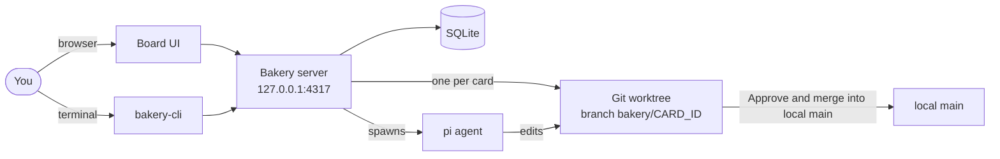
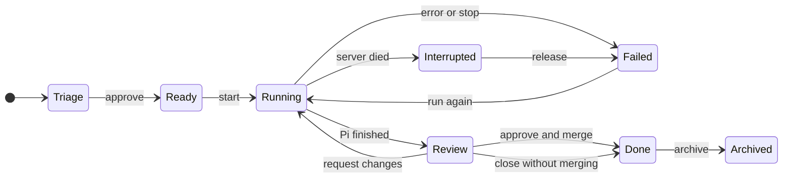
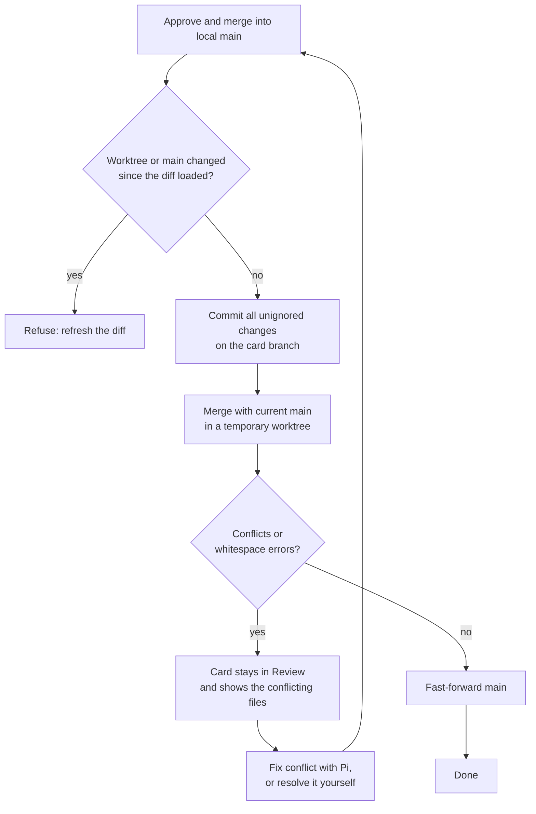
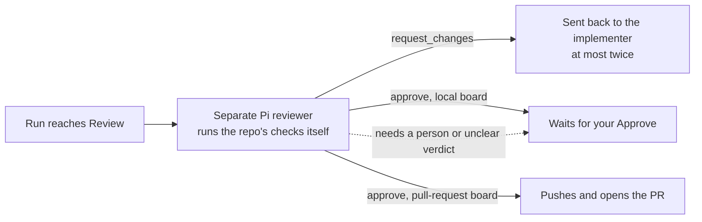
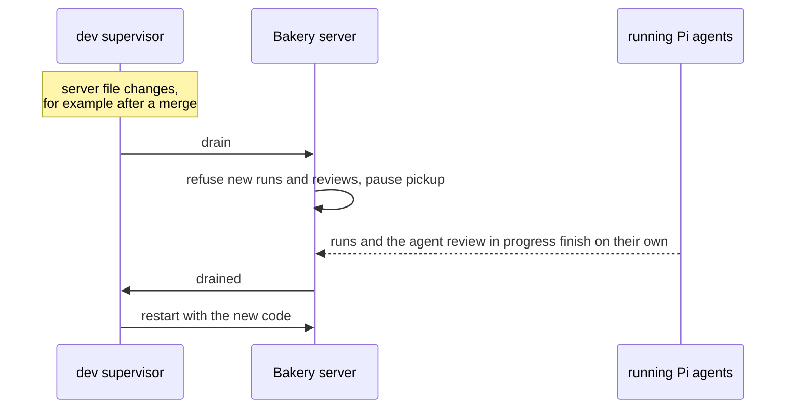

# Bakery reference

The full feature reference. For an overview, see the [README](../README.md).

Bakery is a local kanban board that hands coding tasks to Pi agents, one Git worktree per card. Nothing reaches your `main` branch until you approve it.

Bakery doesn't push, deploy, or write to an issue tracker unless you turn it on. PRs open only on GitHub pull request boards, and a board can opt in to pushing `main` after each local merge (see [Reviewing and merging](#reviewing-and-merging)).



## Contents

- [Quick start](#quick-start)
- [Today](#today)
- [Card lifecycle](#card-lifecycle)
- [Dependencies](#dependencies)
- [Visualizer](#visualizer)
- [Reviewing and merging](#reviewing-and-merging)
- [GitHub pull request mode](#github-pull-request-mode)
- [Sentinels](#sentinels)
- [Optional features](#optional-features)
- [Watching a run](#watching-a-run)
- [Automation (opt-in)](#automation-opt-in)
- [CLI](#cli)
- [Boards and lanes](#boards-and-lanes)
- [Server, data, and restarts](#server-data-and-restarts)
- [Safety](#safety)
- [Development](#development)
- [Releasing](#releasing)

## Quick start

You need Node 24, Git, and `pi` on your `PATH` with a configured provider.

```sh
npm install
npm run dev
```

Open http://127.0.0.1:5173.

`npm run dev` runs the server under a supervisor that owns ports 4317 and 5173 (the server listens on 14317 and Vite on 15173) and reloads the server when code changes. While the server or Vite is down, page loads on either port get a static status page with elapsed and typical restart time, which reloads when the server is back.

To run a single production server instead, run `npm run build && BAKERY_SERVE_UI=1 npm start` and open http://127.0.0.1:4317. To keep it running in the background, see [Running as a service](#running-as-a-service).

Then:

1. Add a repository by entering its Git root, either an absolute path or a `~/` path. The repository needs at least one commit, because worktrees start from `HEAD`.
2. Create a card. New cards start in **Triage**.
3. Move the card to **Ready**, then start it. Starting a run uses paid model tokens.
4. When Pi finishes, the card moves to **Review**. Read the diff, then **Approve and merge into local main** (or **Approve and open PR** on a github-pr board) or **Request changes**.

Uncommitted or untracked files in your checkout don't appear in card worktrees.

## Today

Bakery opens on **Today**, which covers every repository at once. After you open a board, Bakery reopens on that board until you click **Today** in the sidebar again.

- **Since your last visit** gives a count of cards merged since you last opened Bakery, how many cards need you, and the last-24h cost across repositories.
- **Capture** adds a Triage card to the repository you pick. Bakery remembers the repository. From a terminal, `bakery-cli add ...` does the same thing for the repository you're in.
- **Needs you** lists Review cards (longest-waiting first), then Failed and Interrupted cards. The sidebar shows the same count next to **Today**.
- **Review N cards** opens Review cards one at a time, oldest first. When a card leaves Review, either because you approved it or because it ran again, the next card opens. **Next card** skips ahead. Closing the card ends the queue.
- **Running** and **Finished since your last visit** list the rest. Click any card to open its details.

### Worktrunk hooks

If [Worktrunk](https://worktrunk.dev) is installed, Bakery runs your repository's creation hooks in each new card worktree before Pi starts. Use them to install dependencies or copy `.env` and other ignored files (`wt step copy-ignored`). Hooks live in `.config/wt.toml` in the repository, or in `~/.config/worktrunk/config.toml`.

- `pre-start` hooks run first, and Pi waits for them. If one fails, the attempt fails with the hook output in its transcript. Bakery removes the new worktree and branch so the next attempt runs the hooks again.
- `post-start` hooks start in the background, as they do under `wt switch`.
- Hooks run only when Bakery creates the worktree. Retries and conflict repairs reuse it without running them.
- Bakery passes `--yes`, so project hooks run without Worktrunk's approval prompt. Pi runs commands in the same worktree anyway.
- Bakery still picks the worktree path and handles review and merge itself. It doesn't call `wt switch` or `wt merge`.

## Card lifecycle



- **A finished run only reaches Review.** Only your approval, or a pull request opened by unattended review merging on GitHub, moves a card to Done.
- **Stop** and the 60-minute run timeout both end a run as Failed. Ten minutes before the timeout, Bakery steers a run that is still going to stop starting new work, commit nothing, and write its report with evidence attached. A run that settles before the timeout keeps that report and reaches Review. Bakery loads `scripts/pi-wrap-up.mjs` into each run with `pi -e` to deliver the message, since Pi's JSON mode reads no input.
- **Close without merging** moves a Review card to Done after a confirmation, or from the CLI with `bakery-cli close CARD_ID`. The worktree and branch stay, and **Reopen** returns it to Review. It never touches Linear or GitHub.
- **Mark done** closes a Triage or Ready card that never ran. An unrun Ready card can also go back to Triage.
- **Retries reuse the card's worktree and Pi session**, so Pi continues where it left off.
- **A rejected session is recovered, not resumed.** When the provider answers HTTP 400 `invalid_request_error` about the `messages` array (for example `messages.103: role 'system' must precede an 'assistant' message`), the saved session replays the same history and fails every time. The run is marked as a provider failure, not a clean exit, and Run again refuses it (HTTP 409 `session_rejected`). Bakery starts one automatic recovery: a fresh Pi session in the same worktree, with the card's uncommitted edits, review comments, CI feedback and last report. A recovery that is rejected again stops; **Recover in a fresh session** on the card (or `bakery recover CARD_ID --yes`) tries again by hand. The old session file and run log are kept, and the card history records each recovery. Billing, authentication, other HTTP 400 errors and temporary errors (429, 5xx, network) are never recovered this way.
- **Interrupted** cards can't be retried until you check the worktree and release the card. Bakery first confirms that the recorded PID is no longer running. A PID reused by an unrelated process also blocks release.
- **Reopen** returns a Done card to Review when its work was left unmerged in the worktree. If the card was already merged, it returns to Ready.
- **History** (Details tab, collapsed) lists every status change with its reason, plus agent-review verdicts and notes such as a failed restart after the reviewer sent a card back. Changes made before this existed show attempts and reviews only.
- **Restore to Done** brings an archived card back. **Archive** only changes the lane. Runs, worktrees, branches, and history stay.
- Only Done cards can be archived. To archive several at once, use **Select** in the Done lane.
- **Moving a Triage card to Ready** (its button, a drag, or a bulk move) checks the card's text first, since these are the cards reviewers send back most. A card that asks for something only a person can do (a physical device, screenshots or recordings by hand, staging or production, someone's sign-off) or never says what done looks like (no Acceptance section, checklist, or "should"/"must" sentence) shows its flags with **Edit** and **Ready anyway**. Nothing is blocked: **Ready anyway** moves it, **Edit** opens the card's edit form, and closing the dialog leaves it in Triage. Sentinel cards and cards that already ran are not checked. The rules are plain text matching in `src/card-lint.ts`.
- **Drag a card** to move it to a lane its buttons could also reach: Triage ↔ Ready, an unrun card to Done, Ready or Failed to Running (this starts Pi and asks first if run confirmations are on), Done ↔ Archive. While you drag, valid lanes are outlined and the others fade. Review, Interrupted, and Reopen still go through the card's buttons, since they need a diff review or a worktree check.

## Dependencies

A card can depend on other cards on the same board. It doesn't start until every card it depends on is Done or archived, so its worktree is cut from a `main` that already has their work.

- A blocked card stays in Ready and shows **Waiting on N**. Its details list the cards it depends on, each linking to that card, and let you add or remove one. The cards it blocks show under **Needed by**.
- Automatic pickup skips blocked cards. They don't use a concurrency slot or the daily limit.
- Starting a blocked card from the UI, API, or CLI fails with an error naming the unfinished cards. Retrying a card that already has attempts isn't blocked, because it already has a worktree.
- When a card merges (Approve on a local board, or its pull request merging), Bakery brings each card in Review that depends on it up to date with `main` (`origin/main` on a pull-request board), so it doesn't conflict later. The card's work stays uncommitted; the branch fast-forwards, or gets a merge commit when it has commits of its own. A clean update queues agent review again. A conflict changes nothing and shows as the usual merge conflict, with **Fix conflict with Pi**. A card with an agent review or an approval in progress is updated once that finishes, and then reviewed again. Cards with an open pull request are left alone, since GitHub already checks them against main.
- Bakery rejects a card depending on itself, on a card from another board, or on a card that would create a cycle.
- If a card you depend on is gone from the database, Bakery drops that dependency on startup.
- The API takes `dependsOn: [ids]` when creating a card, `POST /api/boards/:board/cards/:id/dependencies` with `{ "dependsOn": id }`, and `DELETE .../dependencies/:dependsOn`. Card JSON includes `dependsOn` and `blocked`.
- Done means Bakery's own Done. If a card's work reaches `main` some other way, such as a squash-merged PR you `git pull`, Bakery doesn't notice, and a started card can't be marked Done by hand. Remove the dependency with `undepend` instead.

## Visualizer

**Visualizer** under a repository in the sidebar draws that board's cards as a dependency graph, with each card pointing at the cards that depend on it. Colors and motion show state: a working card pulses, a blocked one is dashed, a done one is solid.

- Hover a card to trace its whole chain, upstream and downstream. Everything else dims.
- Click a card to open its details over the graph, the same panel the board uses. Escape closes it. Drag to pan, scroll to zoom, `f` or double-click to fit.
- The header counts cards per state and has the **Done** filter. **Relevant** (the default) keeps finished cards only while an unfinished card still depends on them. **All** and **Hide** do what they say. The legend sits in the corner of the graph.
- Without WebGL, the graph is drawn as plain SVG from the same layout, with the same colors and labels but no animation.
- The graph updates from the same 2 s card poll as the board. The **Glow** control only applies to the WebGL view.

## Reviewing and merging

The Review diff shows what the card changed since its branch split from `main`, including unignored files the agent didn't commit. Newer work on `main` doesn't show up as deletions.

The diff toolbar switches between unified and split layouts and picks a syntax theme (Bakery, GitHub, One, Catppuccin, Solarized, Gruvbox, Rosé Pine, or Vitesse). Each theme has a light and a dark variant that follows Bakery's theme. This browser remembers both choices.

To request revisions:

1. Select a line, write a comment, and add it as a draft.
2. Click **Request changes** to submit the drafts. Bakery starts the next attempt right away, and Pi gets your comments in its prompt. If the attempt can't start (Bakery is restarting, say), the card says why; click **Run again** once it can.

Drafts must be submitted or removed before you can approve. Comments stay as history on later diffs, where their line positions may have moved.

When you approve:



In the repository's settings, **Push main to origin after merging** (local-merge boards, off by default) runs `git push origin main` after the fast-forward, for agent-reviewer merges too. If the push fails, the card stays Done and its History says why.

- Manual approval doesn't run tests or CI, and doesn't push.
- Bakery commits and merges as you: your Git `user.name` and `user.email`, signed if your config signs commits (`commit.gpgsign`). Only a repository with no name or email configured gets `Bakery <bakery@localhost>` in its place.
- Your own uncommitted edits on `main` stay in place. Git refuses a merge that would overwrite them.
- **Fix conflict with Pi** starts a new attempt in the card's worktree. Pi may merge `main` into the card branch and commit there, but must not touch `main`.
- After a conflict fix, you review the result again before it merges.
- If approval fails in another way, **Withdraw approval** unlocks the card for revision. It never removes commits or worktrees. If `main` has already moved, Bakery refuses and asks you to inspect.
- Diffs over 200 files or 2 MB can't be approved in Bakery. Binary files need checking in the worktree.
- If you merge a card's branch into `main` yourself, Bakery notices on its next tick and marks the card Done. This only applies when the worktree is clean and the merge actually changed `main`.

## GitHub pull request mode

Off unless `BAKERY_FEATURE_PULL_REQUESTS=1` (see [Optional features](#optional-features)).

A board integrates either locally, where Approve merges into local `main`, or through GitHub pull requests, where a card is Done only when its PR has merged on GitHub and the merge commit is on `origin/main`.

The default depends on the repository. When you give a board a GitHub remote link (`https://github.com/OWNER/REPO`), Bakery asks GitHub whether `main` accepts direct pushes: `gh api repos/OWNER/REPO/rules/branches/main` for rulesets, then `gh api repos/OWNER/REPO/branches/main/protection` for branch protection. If a ruleset requires a pull request or a merge queue, or branch protection requires pull request reviews, the board switches to **GitHub pull requests**. Otherwise it stays **Local merge**. The board's settings show what Bakery found.

- **Your choice wins.** Once you pick a mode under Integration in the board's settings, or with `bakery-cli board --integration local|github-pr`, Bakery never changes it.
- **Protected main on a local board.** If a board is on Local merge, `main` only accepts pull requests, and you haven't chosen Local yourself, Approve refuses and points you to the Integration setting. Merging locally would leave local `main` ahead of GitHub with no way to push. Pick **GitHub pull requests**, or click **Keep Local merge** (or run `bakery-cli board --integration local`) to merge locally anyway. Boards that already had a GitHub remote are checked once when the server starts. That check only records protection; it doesn't change their mode.
- **When Bakery can't tell.** If `gh` is missing, isn't signed in, or can't read the rules (branch protection needs admin access unless a ruleset already answered), the mode is left as it was, local Approve works as before, and the board's settings say why. The check runs again the next time the server starts or the remote changes.

Add a repository as a board from the terminal with `bakery-cli board-add [PATH]` (the current directory by default).

To switch by hand, pick **GitHub pull requests** under Integration in the board's settings, or run `bakery-cli board --integration github-pr`. Either way, the repository's `origin` must be that GitHub repository, and its default branch must be `main`.

[`gh`](https://cli.github.com) is required. If `gh` is missing or `gh auth status` fails, the board shows the error and Bakery does nothing on that board: no PR polling, no fetch, no automatic pickup. It never falls back to local detection. Set `BAKERY_GH_BIN` to use a different `gh` binary.

What changes in this mode:

- **New card worktrees** start from a freshly fetched `origin/main`, not from the local checkout's `HEAD`.
- **Approve and open PR** opens a dialog with a draft title and body to edit, then commits the reviewed changes on `bakery/<card>`, pushes that branch to `origin`, and runs `gh pr create` with them. Bakery appends a footer naming the card, plus the run summary. If the repository has a pull request template (`.github/PULL_REQUEST_TEMPLATE.md`, also at the root or in `docs/`) or a semantic-PR title check (an `amannn/action-semantic-pull-request` workflow, or `.github/semantic.yml`), Pi drafts the title and body from them, the card, the run output, and the diff. The drafting run has no tools and uses the board's review model. Otherwise the draft is the card title and description, and no agent runs. A title that fails the check's types or scopes is refused before anything is pushed. Nothing merges locally. If the branch already has an open PR, Approve pushes the new commits to it and leaves its title and body alone. `gh` errors appear on the card word for word. Pi is still told never to push or open PRs. Your Approve is the authorization (or the agent reviewer's approval, with unattended review on). Bakery comments on the PR at each turning point: when it pushes an update (and whether a person approved it or it was an automatic CI fix), when it sends the card back for failing CI, and when it gives up after the fix-run limit. A CI fix run may also add or remove labels on its own PR, edit its description, and comment to explain why, for checks that a label or description line satisfies.
- **Getting ready at Review.** When a run reaches Review, Bakery drafts the PR title and body and runs the repository's hooks on the work while you review it, so Approve only pushes. It commits the work on `bakery/<card>` (pre-commit and commit-msg hooks run), then runs the pre-push hook on that commit with `git push --dry-run`, which pushes nothing. It checks one card at a time per repository. If you approve exactly that commit, Bakery pushes with `--no-verify`. If the work changed since, or Bakery couldn't run the check, the hooks run on Approve as before. A hook that refuses the work at Review goes back to the implementer right away, as a refused push does, up to 2 times in a row; after that the card waits for you. A hook that rewrites files (a formatter) changes the diff under review. Boards with auto-review or automatic pull requests skip this, since they push at Review anyway. A new attempt stops a check that's still running.
- **Linking a PR.** Bakery finds a card's PR by its `bakery/<card>` branch. If your branch naming differs, attach the PR link on the card, or run `bakery-cli pr CARD_ID URL` (`off` clears it). A linked PR is only watched; Bakery doesn't push to it.
- **Polling.** About once a minute per board, Bakery makes one `gh pr list` call for the board's Review cards:
  - **Open:** the card stays in Review and shows the PR number and checks state. The button becomes **Approve and update PR #N**, which pushes new reviewed work to that PR.
  - **Open with failing CI:** once the failed checks have finished (and the rest have too, or 10 minutes have passed), Bakery sends the card back to Pi with each failed check's name, link, and the tail of its `gh run view --log-failed` log. When the fix run reaches Review, the next sync pushes it to the same PR without waiting for Approve, unless you've left review comments on it. Runs you start yourself still wait for Approve, and the PR still needs its normal review to merge. Each pushed commit is sent back once, only when the card worktree is clean and holds that commit, and at most 3 times per card; after that the card shows why it stopped. Cancelled and action-required checks are shown but not sent back, and only the newest run of each check counts. If CI passes before the fix run starts, the failures are dropped. A linked PR (one Bakery doesn't push to) is never sent back. Neither is a draft PR, since many repositories skip CI on drafts; the card says so, and marking the PR ready lets the next sync send it back.
  - **Merged:** Bakery fetches `origin` and checks that the merge commit is an ancestor of `origin/main`. If it is, the card moves to Done and the merge is recorded. If not yet, the card stays in Review and Bakery checks again next time.
  - **Closed without merging:** the card goes to Needs you with the reason.
- **Cleanup.** After a card is Done, Bakery removes its worktree and local branch (with `wt remove` when Worktrunk is installed). Squash merges aren't ancestors of the branch, so the branch is force-deleted, but only after GitHub has confirmed the merge.
- **Retries.** When you rerun a card whose committed branch is behind `origin/main` and hasn't been pushed, Bakery rebases it onto `origin/main` before Pi starts. If the rebase conflicts, the attempt goes to Needs you and the branch is left as it was. Cards in Review are never rebased, because that would change what you reviewed.
- **Requesting changes from the PR.** A comment on an open PR that starts with `/bakery` sends the card back to Pi with the comment as requested changes. So does a submitted review (Request changes or Comment) whose summary starts that way (`@bakery` is not used: it would notify an unrelated GitHub account): its inline comments go along, with their file and line. Only the repository's owner, members and collaborators count; anyone else's comment is ignored, and Pi is told these are requests to weigh, not orders. Bakery replies on the PR. Each comment is sent once, comments from before Bakery first looked at the PR are not replayed, and a linked PR (one Bakery doesn't push to) is never sent back. It is sent only when the card worktree is clean and holds the PR head; until then the request waits. Unlike a CI fix, the new attempt waits for your Approve before it is pushed. Bakery reads comments on its normal sync (every minute).
- **Requesting changes on any PR.** A comment that starts with `/bakery` from the repository's owner, a member or a collaborator, on any open PR in the repository, not only Bakery's own, becomes a Ready card within about a minute. The card checks out the PR's branch, makes the change, and Bakery pushes it to that branch when the run finishes, without waiting for Approve, because the commenter asked for it. It reads conversation and inline comments (not review summaries), skips PRs from forks (it says so on the PR), and while a request card for a PR is open, newer comments on it wait. Comments from before Bakery first looks at a repository are not replayed. Cards for these requests don't count toward the sentinel's limits.
- **Automatic pull requests.** In the repository's settings, **Open pull requests automatically** (pull-request boards, off by default) pushes `bakery/<card>` and opens the PR as soon as a run reaches Review, drafting the title and body as Approve does, without waiting for you. Its PR comment says no person reviewed the push. Only runs that finish after you turn it on are pushed, and only a card's first PR (later pushes still need Approve, apart from CI fixes). If the draft needs a person, or the push or `gh` fails, the card stays in Review with the reason in its History. A pre-push hook refusal goes back to the implementer; after three automatic attempts on one card, it waits for Approve. With auto-review on, the agent reviewer's approval opens the PR instead.
- **Unattended review.** With auto-review on, an agent approval does what Approve does: Bakery drafts the title and body the same way, pushes `bakery/<card>`, and opens the PR (or updates the open one). Its PR comment says the agent reviewer approved the push and no person reviewed it. The card then waits on GitHub and goes Done when the PR merges. If the draft needs a person (the title fails the semantic-PR check, or drafting fails), or the push or `gh` fails, the card stays in Review for you. A pre-push hook refusal goes back to the implementer, as it does after Approve. See [Unattended review](#unattended-review).
- Local merge detection is off for these boards.

### Keeping local main current

In this mode the main checkout is never a workspace. Every card works in its own worktree, so local `main` should always be clean and at or behind `origin/main`. On each sync, and right after a card goes Done, Bakery runs `git fetch origin --prune` and then `git merge --ff-only origin/main` in the main checkout.

Main only ever fast-forwards. If it has uncommitted changes, has local commits, has diverged, or isn't checked out, Bakery doesn't reset, rebase, stash, or force anything. It shows the problem on the board and pauses automatic pickup there until a later sync succeeds. Untracked files don't block the sync unless the fast-forward would overwrite them.

### Cards merged locally before the switch

A card approved while the board used local merge is Done, but its work may only be on local `main`. Board settings list these cards (Done, merged by Bakery, approved commit not on `origin/main`). On a GitHub pull request board each has **Publish as PR**, also shown on the card. It pushes the approved commit to `bakery/<card>`, opens the PR the same way Approve does, clears the local merge record, and moves the card back to Review. The card goes Done again when the PR merges and reaches `origin/main`.

Publishing is refused when the approved commit sits on top of other local merges that `origin/main` lacks, since they would ride along in the PR. Publish the earlier card first, or rebase the card branch onto `origin/main` yourself. A plain push is used, so an existing `bakery/<card>` on GitHub with other commits is never overwritten.

Publishing doesn't touch local `main`. Once every local commit on `main` is a Bakery card merge whose work is on `origin`, Bakery offers to reset `main` to `origin/main`. It saves the old tip as `bakery-recovery/<sha>` first and resets only after you confirm that tip. It won't offer the reset if `main` isn't checked out, has uncommitted changes, or holds any other commit, and `git reset --keep` refuses rather than overwrite untracked files.

### Not detected

- **Reverts after merge.** Once a card is Done, Bakery doesn't watch for its PR being reverted.
- Force-pushes that rewrite `origin/main` after a card is Done.
- PRs merged into a branch other than `main`. They never reach `origin/main`, so the card stays in Review.

## Sentinels

Off unless `BAKERY_FEATURE_SENTINELS=1` (see [Optional features](#optional-features)).

A sentinel is a persistent monitor, not a card. It never enters Triage, Ready, Running, Review or Done, is never reviewed or merged, and is not counted in lane counts, Today or SDLC stats. A pull-request board has two, listed under **Sentinels** in the sidebar:

- **Broken pull requests** looks every 5 minutes (`BAKERY_SENTINEL_MS`) for open PRs by the repository owner that conflict with main or fail CI.
- **/bakery requests** looks every minute for `/bakery` comments on any open PR.

Each has instructions (added to every job's brief), a schedule, an enabled or paused state and a next-run time. Each execution is a run with its start and end, outcome, findings and any error; the Sentinels screen shows the latest runs. **Pause** stops future runs and holds jobs that have not started; **Resume** runs it at once; **Run now** runs an enabled sentinel on the next check. `bakery-cli sentinels`, `sentinel-pause`, `sentinel-resume` and `sentinel-run` do the same from a shell, and `PATCH /api/sentinels/:id` takes `enabled`, `intervalMs` and `instructions`. Changing `intervalMs` moves the next run to one new interval after the last run (or now, if that has passed), so shortening takes effect at once. Jobs that are queued but not started are checked against their pull request again before they start, including after a resume or restart, and are withdrawn if it was fixed, merged or closed. A job card, its attempt record and its Ready status are saved together, so a crash cannot leave a finding that later runs skip; an older half-made card is recovered on the next run. `BAKERY_SENTINEL=0` turns them all off: no timer, no run-now (the API answers 409), and no dispatch on resume.

What a sentinel finds becomes an ordinary job card, linked back by sentinel, run and a stable finding key (`pr:<number>` for a broken PR). The card runs on the usual worker, with the same logs, usage and budget, and Bakery pushes its result to the PR branch itself, so Approve, merge and auto-review do not apply to it. While a finding's card is open, later runs add no second card for it. Once that card is Done and the PR is still broken (a new head or main), the next run makes a new card, up to three per PR. Finishing a card never completes or pauses its sentinel. A run only one process can hold at a time, and a run cut off by a restart is marked interrupted.

Jobs made before sentinels had records are linked to their sentinel on first start, keeping their ids, status, PR locks and any running agent. The link is made in one transaction and is safe to repeat.

## Optional features

Sentinels and GitHub pull requests are optional and **off by default**. Each has its own switch, and the two are independent:

| Switch | Turns on |
| --- | --- |
| `BAKERY_FEATURE_SENTINELS=1` | Sentinels: the Sentinels page, their routes and their background scheduler. |
| `BAKERY_FEATURE_PULL_REQUESTS=1` | GitHub pull request mode: the Pull requests page, the Integration mode choice, publishing, automatic pull requests, GitHub sync and polling. |

Unset, empty or `0` means off; any other value is an error. Set the switch both when you build the UI and when you start the server, because the UI has it compiled in and the server reads it at start (`/api/status` reports what the server runs with). For example, `BAKERY_FEATURE_PULL_REQUESTS=1 npm run build && BAKERY_FEATURE_PULL_REQUESTS=1 BAKERY_SERVE_UI=1 npm start`; for a service, put both in its environment and in the environment of `scripts/update.sh`. `src/features.ts` is the one definition both sides read.

With a feature off:

- Its screens, navigation and settings are not shown, its routes answer `404` with `code: "feature_off"` and the switch to set, its timers never start, and it needs no configuration (`gh` included).
- Stored data is kept, not deleted. A board set to GitHub pull requests reads as Local while pull requests are off, and goes back to its stored mode when you turn them on; sentinels, their runs and their job cards come back the same way.
- Cards, runs, local review and Local merge work as usual.
- Bakery never falls back to merging locally when the board needs a pull request. If the board is set to GitHub pull requests, or `main` on GitHub only accepts them and you haven't chosen Local merge, Approve is refused with a message saying so; set the switch or choose Local merge in the board's settings.
- Sentinels need only a GitHub remote link on the board, not pull request mode, so with only Sentinels on they watch boards that merge locally too. A stored sync error is kept but ignored (it does not pause automatic pickup) while pull requests are off.

## Watching a run

Each attempt in a card's **Attempts** list shows:

- The agent that ran it as `provider/model`, for example `anthropic/claude-…` or `openai-codex/gpt-…`. The board card shows the latest run and review agents.
- A transcript: assistant text, plus one line per turn with tool counts, failures, and changed files. Tool arguments and results aren't stored. Pi's own session has the full conversation.
- Its cost, as reported by Pi on each assistant message. Hover it for input, output, and cache token counts. Attempts from before Bakery tracked usage show `—`, not `$0.00`. The heading shows the card's total across all attempts and agent reviews.
- The worktree path, with **Copy path**. Failed attempts have **Copy error** instead, which copies a prompt you can paste into an agent: card, repo, worktree, error, and the end of the output.

The clock on a card counts completed Pi turns across attempts. Older runs show an estimate marked with `~` or `?`.

A card that has run more than once shows an amber attempt count, in every lane including Done and Archive, so cards that needed rework stand out. The **Attempts** list in card details starts with the attempt count and the number of review rounds, meaning reviews that ended in **Request changes**.

Provider errors show only their HTTP status. Pi's stderr goes to the server console, not the board, because it can contain request details.

## Automation (opt-in)

Both features are off by default and set per repository in **Settings**. Both can start paid Pi runs, and both need the server to keep running.

The board header shows **Last 24h**: the cost of attempts and agent reviews that are running or finished in the last 24 hours.

### Automatic pickup

The server starts Ready cards for you, highest priority first, then oldest first. Priority is a whole number from -100 to 100 (default 0); `low`, `normal`, `high` and `urgent` are shorthands for -10, 0, 50 and 100. Set it when you create or edit a card, or from its details. Lanes list higher-priority cards first, and a card with a non-zero priority shows the number in its footer, warmer the higher it is.

- **Concurrency:** 1 to 4 runs at once (default 2). Manually started runs count toward it.
- **Agents at once, all boards:** card runs and agent reviews on every board share this many slots, since each ends with the repository's tests. Automatic (the default) is a quarter of the CPU cores, at least 2. Set it in **Settings > General** or with `bakery-cli agents N|auto`. Automatic work (pickup, reviewer send-backs, CI, hook and conflict fixes, sentinel jobs, agent reviews) waits for a slot. A run you start yourself counts toward the limit but always starts.
- **Limits:** the daily limit, the daily cost budget and the agent reviewer's diff caps are spend limits. They apply only when the board's **Limits** switch is on, which is off by default, so a development board runs unthrottled. Turn it on in the board's settings or with `bakery-cli limits on`; the stored values are kept while it's off. Concurrency and the loop guards (reviewer and hook send-backs, CI-fix runs, conflict repairs, automatic retries, the 60-minute run timeout) always apply. All of them are decided in `server/repo-limits.ts`.
- **Daily limit** (when limits are on): 1 to 99 automatic starts in any rolling 24 hours (default 6), or 0 for no limit (`--limit off` in the CLI). At the limit, pickup waits and the board shows when the next slot opens. **Reset start limit** starts a new window and may start runs immediately.
- **Daily cost budget** (when limits are on): optional, off by default. When the board's last-24h cost reaches it, pickup waits and the board says why. Pickup resumes as older spend leaves the window, or when you raise or clear the budget. Running work isn't stopped, and manual starts still work. Cost comes from Pi's own pricing, so it's an estimate and can overshoot by whatever runs were already in progress.
- **Failed runs:** a card whose automatic run fails waits in Failed, and pickup carries on with the other Ready cards. Pickup never restarts a failed card, except for the automatic retry of a provider error.
- **Pauses:** pickup pauses on an interrupted card, a startup error, or an authentication or billing refusal from the provider (which would fail every card), and the board shows why. Turn it back on once you have dealt with it.
- Turning pickup off stops new starts. Runs already in progress keep going.

### Unattended review

A separate Pi agent reviews finished cards without you. It never merges into local `main`: on a local board an approved card waits for your **Approve**, and on a [GitHub pull request](#github-pull-request-mode) board Bakery opens the PR and GitHub decides the merge.



- It's set per repository. Open the repository's edit (pencil) dialog and enable it.
- Bakery only considers runs that reach Review after you enable it.
- Failed reviews aren't retried.
- The reviewer reads the repository's `AGENTS.md`, `CLAUDE.md` and review instructions and runs the checks they ask for itself, instead of sending the card back for missing proof. Checks only a person can do, such as device runs, screenshots or staging access, leave the card for you.
- Turning the setting off stops a review in progress from opening a PR.
- The reviewer is a full Pi agent in the card's worktree, with the same tools, extensions, skills, and context files as a card run. It can read code and run builds or tests, and runs locally with your permissions. It's told not to change anything; if the work changes during review, the card is left for you.

## CLI

The CLI talks to the running server's HTTP API, so it goes through the same checks as the UI.

```sh
npm run bakery -- add fix the flaky login test [--priority 80]
npm run bakery -- doctor
npm run bakery -- boards
npm run bakery -- cards [--all] [--watch]
npm run bakery -- tui
npm run bakery -- create --title "..." --body "..." [--key KEY] [--priority -100..100|low|normal|high|urgent] [--after CARD_ID]...
npm run bakery -- show CARD_ID
npm run bakery -- depend CARD_ID --on CARD_ID
npm run bakery -- undepend CARD_ID --on CARD_ID
npm run bakery -- edit CARD_ID [--title "..."] [--body "..."]
npm run bakery -- archive CARD_ID...
npm run bakery -- restore CARD_ID
npm run bakery -- stats
npm run bakery -- ready CARD_ID [--yes]
npm run bakery -- triage CARD_ID
npm run bakery -- start CARD_ID... --yes
npm run bakery -- recover CARD_ID --yes
npm run bakery -- runs CARD_ID
npm run bakery -- conflicts
npm run bakery -- pickup [on|off|reset] [--concurrency 2] [--limit 6] [--budget 5|off] [--yes]
npm run bakery -- board [--integration local|github-pr]
npm run bakery -- pr CARD_ID [URL|off]
```

- `doctor` runs setup checks and prints `PASS`, `WARN` or `FAIL` for each, then a count; it exits 1 if any check fails. It checks Node 24, git and its committer identity, `pi` and its model list, Worktrunk (optional), `gh` sign-in (a failure only on boards using GitHub pull requests), the data directory and its lock, whether the server answers, and each board's repository and integration or pickup errors. The server line comes right after the versions and says which instance you reached and whether it's local or remote. Against a non-loopback `BAKERY_URL` it checks only the server and boards, since tools and paths are on the server's machine, and names each board `<host>:<path>`. After the checks come `INFO` rows that never pass or fail: the CLI's path, every `BAKERY_*` variable the CLI sees (names containing `TOKEN`, `SECRET`, `KEY`, `PASSWORD`, `WEBHOOK` or `ENDPOINT` print as `set (hidden)`), and what the server reports about itself: host, build features, active runs, agent models, telemetry and whether a Discord webhook is set. A remote server's own environment variables stay on its machine. `--json` prints the checks.
- `add` is quick capture: the words after it become the title of a new Triage card. It takes the same `--body` and `--priority` as `create`.
- Without `--board`, commands use the board whose repository contains your current directory. Outside every repository, they use the only board, or ask for `--board ID|PATH` if you have several. Add `--json` for full API responses.
- Commands that can start paid runs need `--yes`: `start`, `pickup on`, `pickup reset`, and `ready` on a board with pickup enabled.
- `ready` runs the same check as the board's Move to Ready (see [Card lifecycle](#card-lifecycle)). A flagged card is listed with its flags and stays in Triage; repeat with `--yes` to move it anyway, and the flags still print to stderr. In `tui`, `r` on a flagged card lists the flags and asks `y/N`. The API is `GET /api/boards/BOARD/cards/CARD/ready-check`, which returns `{ flags }` and moves nothing.
- `create --key KEY` makes re-runs safe. If the board already has a card with that key, in any status including archived, the CLI prints that card instead of creating another. Keys are unique per board and up to 200 characters. The API takes the same value as `idempotencyKey` and returns 200 for an existing card, 201 for a new one.
- `cards` on a terminal prints the board's lanes with the web board's badges (failure reason, Your turn, quiet, retries, PR). Archive and all but the 5 newest Done cards need `--all`; `--watch` redraws every 2 seconds. Piped, it prints one tab-separated line per card: ID, status, priority, attempt count, review rounds, and title.
- `tui` is the board driven by keys: arrows or `j`/`k` move, `h`/`l` jump lanes, enter shows a card's latest attempt, `o` opens it in the browser and `?` lists every key. `s` starts or reruns, `x` stops, `a` approves, accepts findings or updates an open PR, `R` recovers, and `r`/`t` move between Ready and Triage. Paid runs, merges and stops ask for `y` first. Opening a new pull request needs its drafted title and body, so the TUI sends that to the browser.
- `show` prints a card's title, status, repository, description, each attempt's status, agent and error, the latest auto-review verdict, and the cards it depends on and that depend on it, each with its status.
- `create --after CARD_ID` makes the new card depend on that card. Repeat it for several. `depend` and `undepend` add or remove one dependency on an existing card. See [Dependencies](#dependencies).
- `edit` changes a card's title, description, or both. `--body ""` clears the description. You can't edit a running card.
- `archive` follows the same rules as the UI: it accepts only Done cards, and if any card isn't Done, nothing is archived. `restore` moves one archived card back to Done.
- `sentinels` lists the board's sentinels with their state, next run and latest run; `sentinel-pause`, `sentinel-resume` and `sentinel-run` take a sentinel ID (see Sentinels).
- `stats` prints the board's card count in each lane and its pickup state.
- `start` takes several cards and starts each one separately. `runs` shows each attempt's error, so you can find failed attempts and retry them. It also shows each attempt's and review's tokens and cost, and the card total. `runs --json` prints `{ cardId, total, runs, reviews }`.
- `open [CARD_ID]` opens the board, or one card, in your browser (`$BROWSER`, else the system opener) and prints the URL. A card ID may be the 8-character prefix. `--print` only prints it, and so does a shell with no display.
- `agents [N|auto]` shows or sets how many agents run at once across all boards.
- `limits [on|off]` shows the board's spend limits, or turns them on or off.
- `pickup` shows the last-24h cost and any budget. `--budget` sets the daily cost budget in USD, and `--budget off` clears it.
- The CLI can't approve merges.
- `board [--integration local|github-pr]` shows the board and switches its integration mode. `pr CARD_ID [URL|off]` shows, attaches, or clears a card's PR link. See [GitHub pull request mode](#github-pull-request-mode).
- To use a different server, set `BAKERY_URL` or `BAKERY_PORT`. To get `bakery-cli` (and its shorter alias `bakery`) on your `PATH`, run `npm link`. `bakery-cli help` lists the commands, and `bakery-cli help COMMAND` shows one command's options. On a terminal the output is laid out in coloured columns (`NO_COLOR` turns the colour off); piped, it stays tab-separated.

## Boards and lanes

- Bakery expands `~`, stores the canonical Git root, and shows the absolute path.
- To fix a board's path, edit the board. Its cards move only if none has run yet, because attempts keep their worktrees in the original repository.
- **Remove repository** hides a board without deleting anything, attached files included. Add the same repository again to restore it.
- Bakery never deletes cards, so a card's attached files stay in `<data dir>/attachments/<card>` until you delete the attachment or purge an archived card's attachments (below). At startup Bakery removes files that no attachment points to, such as an upload cut off by a crash.
- Any lane can be collapsed, even with active cards. Auto-collapse only applies to lanes without active cards, and a board's **Auto-collapse** setting persists. Manual choices last until you reload the page.
- Card descriptions support common Markdown: headings, emphasis, lists and task lists, quotes, code, and `http`, `https`, or `mailto` links. Card details render it, and board cards show a plain-text preview. Raw HTML appears as text and is never rendered.
- In **Settings**, you can turn on a confirmation before each run and choose whether card details open as a popup or a side panel.
- Each repository can have an optional `http` or `https` remote link, such as its GitHub page. Set it with the pencil button next to the repository (Edit repository). It appears below the board heading. The link itself is only a link; pushing is the separate opt-in setting below.

### Pi models

Bakery starts Pi for three kinds of runs. Each can use its own model and thinking level:

- **Card runs**: normal runs and retries.
- **Conflict fixes**: runs that repair a merge conflict.
- **Agent review**: the reviewer used by [unattended review](#unattended-review).

Set global defaults in **Settings → Pi models**. To override them for one repository, use **Pi models** in its Edit repository dialog. A blank field inherits: the repository value comes first, then the global value, then the default in your Pi settings. Model and thinking level inherit separately, so a repository can change only the model and keep the global thinking level.

A model is a Pi model pattern such as `anthropic/claude-sonnet-4-5` or `openai-codex/gpt-5.5`. Bakery passes it as `--model`, and the thinking level as `--thinking` (`off`, `minimal`, `low`, `medium`, `high`, `xhigh`, or `max`). It only passes flags you set. The model field suggests the models `pi --list-models` reports. Bakery caches that list for 10 minutes. A change applies to runs that start after you save it. Retries keep their Pi session but use the current model.

## Server, data, and restarts

- The server listens only on `127.0.0.1` and has no authentication. Don't expose it on a network.
- Data and worktrees live in `~/.local/share/bakery/`. To change this, set `BAKERY_DATA_DIR`. You can also set `BAKERY_PORT`, `BAKERY_PI_BIN` to use a different `pi` binary, and `BAKERY_WT_BIN` to use a different `wt` binary. Set `BAKERY_WT_BIN=` (empty) to turn off Worktrunk hooks. Paste a Discord channel webhook into Settings (or set `BAKERY_DISCORD_WEBHOOK_URL`, which applies when Settings has none) and Bakery posts a message when a run finishes: the card title and the run summary for a card ready for review, or the error for a failed run. Stopped runs are not posted. The URL is a secret: Settings hides it, and it must be a discord.com webhook. **Notify this browser when a card needs you** in Settings turns on Web Push for that browser: a notification when a card becomes your turn in Review (nothing else, such as the agent reviewer or GitHub CI, still holds it) or fails, even with no Bakery tab open. Clicking one opens the card. Each browser turns it on separately, it needs HTTPS or localhost (see [HTTPS on a tailnet](#https-on-a-tailnet)), and cards that already needed you are not replayed. Brave needs **Use Google services for push messaging** turned on (Settings → Privacy and security); without it, and in Chromium builds without Google services, subscribing fails with "push service error". The server checks every 10 seconds and keeps its push key in `push-vapid.json` in the data directory. Set `BAKERY_TELEMETRY_ENDPOINT` to an OTLP/HTTP endpoint to show an opt-in Settings toggle for anonymous usage counts; nothing is sent without both. [docs/telemetry.md](telemetry.md) lists every field. Set `BAKERY_METRICS=1` to serve Prometheus metrics on `/metrics` for your own scraper; [docs/metrics.md](metrics.md) lists them.
- On Windows, Bakery finds `pi`, `wt` and `gh` through `PATH` and `PATHEXT`, and runs npm's `pi.cmd` shim as `node cli.js`. Repository paths can be `C:\\code\\app` or `~\\code\\app`. Data lives in `%USERPROFILE%\\.local\\share\\bakery`. A run's **Stop** ends Pi but not any processes Pi started. An auto-review verification command runs under `cmd.exe`, so write it for that shell.
- Files attached to cards and discussion messages live in `<data dir>/attachments/<card id>/`. Clicking an image thumbnail opens it in a lightbox: the arrow keys, the side buttons or the thumbnail strip step through the other images in the same list, **Full size** shows the image at its natural size (scroll to pan), and **Open original** opens the file in a new tab. Cmd- or Ctrl-click on a thumbnail still opens the file in a new tab directly. Deleting an attachment removes its file. Archiving a card or removing its board keeps the files, because both can be undone. To reclaim the space, use **Purge attachments** on an archived card or `bakery-cli purge-attachments CARD_ID... --yes`. It deletes the card's folder and its attachment records, and it cannot be undone, even if you restore the card.
- Agents keep evidence as attachments too. A work run's prompt tells the agent to save screenshots and other generated files with `bakery-cli attach CARD_ID FILE... --board ID` instead of reporting `/tmp` paths. The command reads each file as the agent's own user, uploads it through the normal attachment route (nothing leaves Bakery), and prints a markdown line such as `` to paste into the report. The report shows attached images inline and falls back to a link when a file is missing. Only Bakery's own attachment and chat-image URLs render as images; a local path in report text is never read. In a GitHub pull request body or comment, Bakery rewrites those relative links to plain text saying the file is kept in Bakery, because screenshots are never published to GitHub.
- Only one server can own a data directory, which it locks with `server.lock`. If the PID in the lock is no longer running, the next server takes over the lock.
- **Stop** ends a run and marks it Failed. Runs time out after 30 minutes.

In `npm run dev`, code changes don't kill running agents. This matters because approving a Bakery card changes Bakery's own server code:



If the server stops during an agent review anyway (a crash, or stopping `npm run dev`), the review is queued again when it starts. A second interruption of the same review leaves the card for you.

If the server crashes, the supervisor restarts it after 1 second, backing off to 30 seconds while it keeps failing. A file change restarts it immediately. Stopping `npm run dev` stops running agents.

The browser takes UI changes from a merge as hot updates, so the board and an open card stay where they were. When Vite has to reload the page instead, each tab reopens its own view, repository and open card.

## Hosting on another machine

By default the server binds to 127.0.0.1 and only accepts local `Host` and `Origin` headers. To run it on an always-on box, put it on a private network such as Tailscale (Bakery has no login of its own):

```sh
bakery-cli service install --host <tailnet IP>
```

Then add `BAKERY_ALLOWED_HOSTS=mochi,mochi.tailnet.ts.net` to `~/.config/bakery/bakery.env` and run `bakery-cli service restart`.

`BAKERY_HOST` is the bind address (prefer the tailnet IP). `BAKERY_ALLOWED_HOSTS` lists extra hostnames, without ports, accepted in `Host` and `Origin`. From another machine, `BAKERY_URL=mochi BAKERY_ALLOW_REMOTE=1 bakery-cli ...` reaches it. Like the desktop and iOS apps, an address without a scheme tries HTTPS, then HTTP, and one without a port uses 4317. Repository paths and merges are on the server's disk.

### HTTPS on a tailnet

Browsers only allow notifications, service workers and installing the page as an app on HTTPS or localhost, so a server reached at `http://<tailnet IP>:4317` can't use them. `tailscale serve` adds HTTPS with the tailnet's own certificate, reachable only from the tailnet:

```sh
tailscale serve --bg --https=443 http://<tailnet IP>:4317
```

Then open `https://<machine>.<tailnet>.ts.net`. Add that name to `BAKERY_ALLOWED_HOSTS`; Bakery accepts HTTPS origins for allowed hosts, so nothing else changes. Serve on a port Bakery isn't using: when `BAKERY_HOST` is the tailnet IP, `--https=4317` collides with Bakery's own listener on that IP and the TLS handshake fails. `tailscale serve status` lists what is served, and `tailscale serve --https=443 off` removes it. The plain HTTP address keeps working for the CLI and the apps.

**Logs** in the sidebar (`g l`) shows the server's own console output: warnings, errors, and a debug line for each API request that fails. It keeps the last 2,000 lines in memory and starts empty after a restart. For older output, read the service manager's log, for example `journalctl --user -u bakery`.

### Running as a service

`bakery-cli service install` runs this checkout in the background: a systemd user service on Linux, or a launchd agent on macOS. It starts at login, restarts after a crash, and checks for updates every 2 minutes. It builds the UI first if `dist/` is missing.

- Settings go in `~/.config/bakery/bakery.env`, which install creates once with `BAKERY_SERVE_UI=1` and `BAKERY_HOST` (`--host`, default `127.0.0.1`) and never overwrites. Put feature switches here too, so the server and the update check both read them.
- `bakery-cli service restart` applies a changed env file. It waits for active runs to finish, as an update does.
- `status` and `logs` show the server's state and its last 200 log lines. `stop` and `uninstall` end active runs at once, so they need `--yes`. Uninstall keeps the env file and the data directory.
- On Linux the service starts at login. To start it at boot and keep it running after logout, run `loginctl enable-linger`; install says so when it is off.
- The unit records where node, npm, `pi`, `wt`, `gh` and git are. After moving any of them, run install again. `bakery-cli doctor` fails while the recorded npm is missing.
- Install rewrites `~/.config/systemd/user/bakery.service`. Keep your own changes in drop-ins under `bakery.service.d/`.
- Windows has no `service` command yet. Start `npm start` from Task Scheduler at logon instead.

### Keeping a hosted server up to date

`npm start` has no file watcher. The service's update check runs `scripts/update.sh` every 2 minutes, which only fetches `origin/main`.

When the fetch brings new commits, a notice in the bottom-left corner says how many and opens their subjects as a changelog. **Update and restart** runs `scripts/update.sh install` (fast-forward `main`, `npm install`, build the UI into `dist-next`). The server then refuses new runs, pauses pickup, waits for active runs and the agent review to finish, and exits. Until then it keeps serving the UI that matches its own API; the restarted server moves `dist-next` over `dist`. When every pending change is UI-only (under `src/`, `public/` or `index.html`, outside the modules the server imports, plus tests and docs), the server installs them by itself within 30 seconds of the fetch (the button reads **Update interface** if you get there first): it swaps the new build over `dist` at once without draining or restarting, keeps the old build's chunks so open pages still work, and open pages offer **Reload**. Updates that need a restart install only when you ask. Run it under a service manager that restarts it, such as a systemd user unit with `Restart=always`. A server under `npm run dev` never updates itself.

## Safety

- Pi is told not to commit, push, or publish during a run. **That instruction isn't a sandbox.** Only run agents on repositories you trust.
- The unattended reviewer runs builds and tests with your permissions.
- Every run, retry, pickup, and review can spend model tokens. Bakery records the tokens and cost Pi reports, but only a daily cost budget stops automatic pickup. Nothing stops a run that is already going.

## Development

```sh
npm test
npm run build          # runs format:check, tsrs, and vite build
npm run format         # fixes formatting in the covered frontend files
```

The formatter check covers the board, card details, review, attempts, usage, API, and model modules. It doesn't cover server or test files yet.

Tests use a fake offline `pi` and temporary Git repositories. They don't call a model or touch repositories you've added to Bakery.

### Next

- Read-only Linear import into local cards, keyed by issue ID. Bakery won't write to Linear.
- Better process identity checks for interrupted runs, beyond PID liveness.
- External CI before approval and automatic card creation.

## Releasing

From a clean checkout of `main`, run `npm run release -- 0.2.0`. It sets that version in `package.json`, `package-lock.json`, `src-tauri/tauri.conf.json`, `src-tauri/Cargo.toml` and `src-tauri/Cargo.lock`, adds a `CHANGELOG.md` section from the merge commit subjects since the last `v*` tag, commits, and creates the tag `v0.2.0`. It doesn't push.

Review the commit, then `git push origin main v0.2.0`. Pushing the tag runs `.github/workflows/release.yml`, which creates a GitHub release using that changelog section as its notes.

## Colleagues prototype (fixture data)

A clickable, fixture-backed prototype of persistent colleagues and group rooms, built from the draft spec in PR #13 for operator review. It is not the feature. It calls no Bakery API, starts no agent, creates no card, writes no memory, and keeps all state in the browser tab (the Reset button restores the fixtures). It is a separate page that is not part of the production build or the board.

```sh
npm run prototype:colleagues
```

Open http://127.0.0.1:5180/prototype-colleagues.html. The code lives in `src/prototype/colleagues/`. Simulated rounds advance only when you click Advance fixture round. The Prototype assumptions page in the app lists the spec choices the prototype made to stay clickable.
